# Nutri Milk Guard — IoT Milk Quality Monitoring System

A complete, production-grade Python + Flask web application for the **VTU Engineering Project** *Nutri Milk Guard*. 
This platform connects directly to the existing hardware-linked **Firebase Realtime Database** (`milk-monitoring-4cb97`) to stream, visualize, evaluate, and log real-time milk quality parameters transmitted by an ESP32 microcontroller with temperature, pH, and volume sensors.

---

## 1. System Architecture

```mermaid
graph LR
    subgraph IoT Hardware
        ESP32[ESP32 Microcontroller]
        DS18B20[Temperature Sensor DS18B20] --> ESP32
        PH[Analog pH Sensor Probe] --> ESP32
        VOL[Liquid Volume Sensor] --> ESP32
    end

    subgraph Cloud Layer
        ESP32 -- "WiFi HTTPS Writes (Overwrite Current)" --> RTDB[(Firebase Realtime Database<br/>milk-monitoring-4cb97)]
    end

    subgraph Python Backend
        RTDB -- "Server-Side Read-Only Stream" --> FBService[app/services/firebase_service.py<br/>Admin SDK + REST Stream]
        FBService --> Norm[app/services/sensor_service.py<br/>Normalization & Ring Buffer]
        Norm --> Quality[app/services/quality_service.py<br/>Rule-Based Assessment]
        Quality --> Alerts[app/services/alert_service.py<br/>Stateful Deduplicated Alerts]
        Alerts --> SSE[app/routes/api.py<br/>Server-Sent Events /api/stream]
    end

    subgraph Browser Dashboard
        SSE -- "Persistent SSE Connection" --> Client[Vanilla JS / live_updates.js]
        Client --> UI[Responsive Dashboard<br/>Live Cards, Badges, Sparklines]
        Client --> Charts[Chart.js Real-time Graphs<br/>Temp & pH vs Time]
    end
```



---

## 2. Verified Firebase Database Structure

Inspection of the live Firebase Realtime Database at endpoint:
`https://milk-monitoring-4cb97-default-rtdb.asia-southeast1.firebasedatabase.app/`
revealed the following schema currently written by the ESP32:

```json
{
  "milk_monitor": {
    "current": {
      "milk_quantity_ml": 0.0,
      "pH": 4.45,
      "temperature_C": 28.75
    }
  }
}
```

### Sensor Field Mapping

| Parameter | Firebase Key | Data Type | Measurement Unit | Hardware Sensor | Normal Range |
| :--- | :--- | :--- | :--- | :--- | :--- |
| **Milk Temperature** | `temperature_C` | Float | °C | DS18B20 Probe | 0.0°C – 10.0°C (Chilled) / ≤ 25.0°C (Intake) |
| **Milk pH Level** | `pH` | Float | pH (0–14) | Analog pH Electrode | 6.50 – 6.80 pH |
| **Milk Quantity** | `milk_quantity_ml` | Float | mL | Volume / Level Sensor | 50.0 – 5000.0 mL |

> **Note on Firmware & Historical Data:**  
> The existing ESP32 firmware continuously overwrites the single node `milk_monitor/current` with its latest readings. To preserve hardware integrity and avoid breaking the existing firmware, **Nutri Milk Guard does not modify the ESP32 database structure**. Instead, the Python server ingests these updates, pairs them with server-side UTC timestamps, and maintains an in-memory ring buffer (up to 500 points) and persistent session cache for live charts and CSV export.

---

## 3. Technology Stack

- **Backend:** Python 3.11+ / 3.14, Flask 3.1+, Firebase Admin Python SDK, `requests`
- **Streaming Protocol:** Server-Sent Events (SSE) with automatic heartbeat keep-alive
- **Frontend:** HTML5, Modern Vanilla CSS3 (Industrial IoT aesthetic, Light Biophilic design system), Vanilla JavaScript (no external framework dependencies)
- **Data Visualization:** Chart.js 4.4+ with custom responsive tooltips and live sliding window
- **Iconography:** Lucide Icons (clean, lightweight SVG)
- **Testing:** Pytest 9.1+ (35 automated tests covering normalization, thresholds, deduplication, and routes)

---

## 4. Milk Quality Assessment Rules

The application implements a rule-based dairy science evaluation engine (`app/services/quality_service.py`) referencing FSSAI and FAO bovine milk standards:

1. **pH Scale Standards:**
   - **Normal (Fresh Bovine Milk):** `6.50 – 6.80`
   - **Warning (Mild Acidity):** `6.20 – 6.49` (Onset of lactic acid fermentation)
   - **Critical (Severely Acidic / Curdling):** `< 5.90` (Active bacterial spoilage, casein precipitation)
   - **Warning (Mild Alkalinity):** `6.81 – 7.10` (Dilution or early mastitis)
   - **Critical (Abnormal Alkalinity):** `> 7.30` (Severe mastitis or chemical adulteration)

2. **Temperature Standards:**
   - **Normal (Optimal Chilled Storage):** `0.0°C – 10.0°C` (Preserves raw milk safety)
   - **Warning (Ambient Intake Ceiling):** `10.1°C – 25.0°C` (Prompt chilling recommended)
   - **Critical (Microbial Growth Hazard):** `> 35.0°C` or `< -0.5°C` (Freezing damages fat emulsion)

3. **Status Classifications:**
   - `Normal`: All sensors within optimal parameters
   - `Warning`: At least one sensor in warning threshold
   - `Critical`: Severe parameter violation requiring immediate inspection
   - `Sensor offline`: Stale readings (no updates from ESP32 within timeout)
   - `Insufficient data`: Missing or non-numeric sensor reading
   - `Thresholds not configured`: Missing threshold definitions

---

## 5. Quick Windows 11 Setup & Run Instructions

### Step 1: Open Terminal in Project Directory
Open PowerShell or Command Prompt in the project folder:
```powershell
cd C:\Users\fardi\Desktop\Nutri-Milk
```

### Step 2: Create and Activate Virtual Environment
```powershell
python -m venv venv
.\venv\Scripts\Activate.ps1
```
*(If PowerShell displays an Execution Policy restriction, run `Set-ExecutionPolicy -Scope Process -ExecutionPolicy Bypass` first).*

### Step 3: Install Required Dependencies
```powershell
# Tip: On Windows machines where PostgreSQL or another tool set a non-existent CURL_CA_BUNDLE,
# clear it before running pip:
$env:CURL_CA_BUNDLE=""
python -m pip install -r requirements.txt
```

### Step 4: Configure Environment Variables
Copy `.env.example` to `.env` (a working local `.env` is already pre-configured):
```powershell
Copy-Item .env.example .env
```

### Step 5: (Optional) Add Firebase Admin Service Account Key
To enable Firebase Admin SDK privileged server access:
1. Go to [Firebase Console](https://console.firebase.google.com/) -> Select **milk-monitoring-4cb97**
2. Project Settings -> **Service accounts** -> Click **Generate new private key**
3. Save the downloaded JSON file as `secrets/serviceAccountKey.json`
*(Note: If omitted, the application automatically connects in secure read-only REST mode using the public project endpoint, so credentials are not mandatory for demonstration).*

### Step 6: Start the Flask Application
```powershell
python run.py
```

### Step 7: Access the Web Dashboard
Open your web browser and navigate to:
**[http://127.0.0.1:5000](http://127.0.0.1:5000)**

---

## 6. Running Automated Tests

A comprehensive automated test suite with 35 tests is included in the `tests/` directory:

```powershell
$env:CURL_CA_BUNDLE=""
python -m pytest -v
```

### Test Coverage Highlights
- `test_config.py`: URL validation, project matching, and exception handling
- `test_quality_service.py`: Fresh vs acidic vs alkaline pH, temperature thresholds, stale handling
- `test_sensor_service.py`: Alias mapping, zero-value preservation (`0.0 mL`), timestamp parsing, CSV export
- `test_alert_service.py`: Alert triggering, stateful deduplication, and auto-resolution
- `test_firebase_service.py`: Network mocks, error handling, subscriber callbacks
- `test_routes.py`: Dashboard (`/`), History (`/history/`), Alerts (`/alerts/`), Settings (`/settings/`), CSV export (`/history/export`), and REST API endpoints

---

## 7. Production Deployment & WSGI Guide

For production deployments on a Linux or Windows Server:
1. Do not use Flask's built-in development server (`run.py` default).
2. Use **Waitress** (for Windows) or **Gunicorn** (for Linux) with multi-threading enabled to support concurrent Server-Sent Events (SSE) connections:

### Windows Production (Waitress)
```powershell
pip install waitress
waitress-serve --listen=0.0.0.0:5000 run:app
```

### Linux Production (Gunicorn)
```bash
pip install gunicorn
gunicorn -w 1 --threads 8 -b 0.0.0.0:5000 run:app
```

> **Important Deployment Note for SSE:**  
> When deploying behind reverse proxies (such as Nginx), ensure proxy buffering is disabled for the streaming endpoint:
> ```nginx
> location /api/stream {
>     proxy_pass http://127.0.0.1:5000;
>     proxy_set_header Connection '';
>     proxy_http_version 1.1;
>     chunked_transfer_encoding off;
>     proxy_buffering off;
>     proxy_cache off;
> }
> ```

---

## 8. Troubleshooting Common Issues

### Issue 1: `OSError: Could not find a suitable TLS CA certificate bundle, invalid path: C:\Program Files\PostgreSQL\...`
- **Cause:** PostgreSQL installation on Windows often sets a global system environment variable `CURL_CA_BUNDLE` pointing to a missing `.crt` path.
- **Solution:** Our `config.py` automatically sanitizes this at runtime. For CLI commands (pip/pytest), clear it in your PowerShell session:
  ```powershell
  $env:CURL_CA_BUNDLE=""
  ```

### Issue 2: Dashboard says "Stale Data (Sensor Idle)"
- **Cause:** The ESP32 hasn't pushed an update to Firebase in over 45 seconds (or whichever timeout is set in Settings).
- **Solution:** Verify the ESP32 is powered on and connected to WiFi. Click the **Sync** button in the dashboard header to test connection health.

### Issue 3: Firebase Permission Denied
- **Cause:** Firebase Realtime Database rules require authentication.
- **Solution:** Place your downloaded `serviceAccountKey.json` into the `secrets/` directory and ensure `GOOGLE_APPLICATION_CREDENTIALS=./secrets/serviceAccountKey.json` is set in `.env`.

---

## 9. Academic Project Identification
- **Project Name:** Nutri Milk Guard
- **Project Type:** IoT-Based Milk Quality Monitoring System
- **Affiliation:** Visvesvaraya Technological University (VTU) Final Year Engineering Demonstration
- **Target Firebase Project ID:** `milk-monitoring-4cb97`
"# NutriMilk-Guard" 
